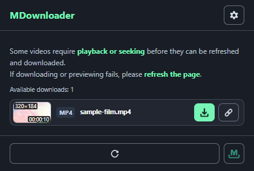
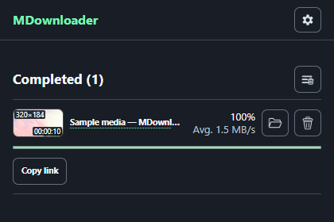

# MDownloader

English · [한국어](docs/README.ko.md)


Find video and audio on the current page, save supported streams, and manage downloads in a side panel.

Chrome · Microsoft Edge · Manifest V3 · English by default · 10 interface languages

MDownloader runs in your browser. It can save direct media files, supported clear or AES-encrypted HLS, and supported unencrypted DASH streams without a separate desktop downloader.

## Installation

1. Obtain this project folder and keep it in a permanent location.
2. Open `chrome://extensions` in Chrome or `edge://extensions` in Edge.
3. Enable **Developer mode**.
4. Choose **Load unpacked** and select the project's **`extension` folder**, which contains `manifest.json`.
5. Pin MDownloader from the browser's extension menu if you want quick access.

No build, npm installation, or paid service is required to load the extension. Store installation links have not been configured in the product website.

To update a local copy, finish active downloads first, replace the project files, and reload MDownloader from the browser's extensions page.

## Screenshots

### Detected media

Review detected items, inspect thumbnails, preview supported media, and start a download.



### Download manager

Track download progress and manage active or completed jobs in the side panel.



These are real captured screens. Capture versions are recorded in the [screenshot catalog](website/assets/screenshots/catalog.json); some current controls are described below even when absent from an older capture.

## Features

- Detect video, audio, and supported HLS/DASH sources on the active page.
- Show thumbnails and hover previews where the media and browser permit them.
- Group confirmed HLS variants under one source and offer quality selection.
- Run multiple independent stream downloads and continue them after the source tab closes.
- Save supported live HLS up to the point received.
- Save a separate partial file while the original download continues.
- Manage progress, speed, pause/resume where supported, cancellation, history, and completed files.
- Customize filenames, download location, interface language, and diagnostics.

Supported interface languages: English, 한국어, 日本語, 简体中文, Español, Português (Brasil), Français, हिन्दी, العربية, Русский.

## Requirements

- Chrome 116 or later, or a compatible current Chromium-based Microsoft Edge with the required extension APIs.
- Access to the page and media server when network detection or stream downloading requires it.
- Enough free storage for temporary segments and the completed output.

## Downloading media

1. Open the page containing the media and start playback.
2. Click the MDownloader icon.
3. Find the item in the media list. Use the thumbnail or hover preview when available.
4. Select **Download**.
5. Open **Download manager** to follow progress and manage the job.

If an item is missing, play the media, seek within it, or refresh the page and try again. Some pages reveal a source only after playback starts.

## Site access

1. Open **Options → Advanced → Network detection permissions**.
2. Choose **Allow all sites**, or enter the page URL under the individual-site form.
3. If the media uses a different server, enter that server URL as well.
4. Allow detection, return to the page, and play the media again.

The browser manages these permissions. You can revoke optional site access from the same options page. Source access can still depend on login state, server rules, or expiring links.

## Choosing HLS quality

Normally, **Download** starts the supported rendition with the highest bitrate.

1. Hold **Shift** while clicking an HLS item's **Download** button.
2. Select a resolution/bitrate from the controls inserted below that item.
3. Confirm the download. Grant access to a separate media server if requested.

Quality controls appear only when multiple supported renditions are available. The list uses confirmed playlist relationships rather than guesses based on filenames.

## Live and partial saves

**Stop and save** ends a supported HLS/DASH transfer and saves its received continuous portion as MP4. It is also available for ordinary finite HLS downloads. The button becomes available once a playable video/audio prefix is ready. It stops new segment requests, lets requests already in progress finish, and saves the continuous portion before the first missing segment. An incomplete finite download receives a partial-file suffix. **Cancel** stops that job without completing its temporary stream output.

**Save received portion** creates a separate partial file and download record while the original job continues. Partial output has its own cancellation and does not replace the original file.

- **HLS/DASH:** uses completed contiguous segments and the available audio coverage.
- **Direct files:** separately reads the reported byte range from the original server, causing additional transfer. The server must support the required access/range behavior, and enough complete packets and metadata must be available.

Partial saving can fail when essential media data is missing or the container/codec cannot be remuxed. Check the partial job's error; the original job remains independent.

## Download manager

- Open the manager from the popup.
- Pause or resume a direct browser download when the browser reports that it supports the action.
- Cancel a selected active job independently of other jobs.
- Use **Show in folder** for a completed browser download.
- Copy a source link or inspect the full filename/address through the row's tooltip where available.
- Delete a record to remove it from the list. The downloaded file stays on disk.
- **Shift-click Delete** to also remove a completed browser-downloaded file when that action is available.
- Section-clear buttons remove the selected section's records, not saved media files.

Hover over an icon button to see its action name. The same controls expose accessible names for keyboard and assistive-technology use.

## Settings

| Setting | Use |
|---|---|
| Display language | Use the system language or select one of ten languages; English is the fallback. |
| Use page title | Combine the current page title with the original filename. |
| Include date and time | Append the local download start time to the filename; ON by default. |
| Download location | Set a subfolder under the browser's default download directory, or choose a folder where supported. |
| Show detected media in the side panel | Display the active tab's media above the download list. |
| Debug mode | Open a separate job diagnostics tab. |
| Record download events | Keep a bounded local result log for troubleshooting. |
| Enable detailed debug logging | Show safe stage codes, timings, and counts in the extension console; OFF by default. |

Filename examples: `Page title_original.mp4` and `Page title_original_YYYY-MM-DD_HH-mm-ss.mp4`. The name and timestamp are fixed when the job is registered. Partial files receive a separate partial-save suffix.

## Supported media

WebRTC appears as a normal media item with a **WebRTC** format badge. Use its regular download button; the existing download manager immediately shows the live job, received bytes and speed. Use the manager's **Stop and save** or **Cancel** controls. Keep the source video tab open; the popup and manager can close while reception continues. This records newly received video/audio in real time, with MP4 preferred and a WebM fallback, up to 2 GiB per recording. [Integration and verification scope](docs/webrtc-integration-2026-11-08.md)

| Media | Support |
|---|---|
| Direct files | HTTP(S) video/audio files, including MP4, WebM, MOV, MKV, MP3, M4A, WAV, FLAC, and OGG families; saved in their original format. |
| HLS | Supported clear or full-segment AES-encrypted MPEG-TS/fMP4 video and audio, including H.264/AAC and supported fMP4 AV1; remuxed without re-encoding. |
| DASH | Supported static single-period fMP4 representations; remuxed without re-encoding. |
| Live streams | Supported live HLS with complete segment boundaries. |
| WebRTC | Normal media item and managed background recording to MP4 or WebM; requires the source video tab to remain open. |

HLS encryption supports `AES-128`, `AES-256` (CBC), `AES-256-CTR`, and `AES-256-GCM` when the playlist supplies a normally accessible `identity` key. Key rotation, explicit IVs, and sequence-number IVs are handled automatically. Encrypted HLS needs no additional setting: use the same Download button. Encrypted low-latency playlists use the complete parent segments.

DRM license systems, sample encryption (`SAMPLE-AES` / `SAMPLE-AES-CTR`), encrypted DASH, live DASH, unknown source protocols, unsupported codecs/layouts, redirects required by stream delivery, and incomplete low-latency groups are outside the supported stream path. A denied or invalid key cannot be used to decrypt media. Stream jobs have a 16 GiB temporary-data ceiling, a 32 MiB resource ceiling, and a 5,000-segment ceiling; browser storage quota may impose a lower limit. See [Development](docs/development.md) for the implementation boundaries.

## Troubleshooting

**Nothing appears in the media list**

Start playback, seek, refresh the page, and check site/media-server permissions. Auxiliary hover previews and advertisements may be excluded from the main list. Detection does not imply that every source can be downloaded.

**A thumbnail or preview fails**

The browser can restrict cross-origin frames, protected sources, or capture APIs. An unavailable preview does not by itself mean the download will fail. Return to the source page and check playback.

**A download fails with a permission or HTTP error**

Check access to both the page and media host, your session, and whether the link has expired. Refresh the source rather than assuming a copied link remains valid elsewhere.

**A partial file cannot be saved**

Wait for more data. Direct-file saving may need additional range reads or tail metadata. Some media cannot be safely packaged from the received portion.

**You need diagnostic details**

Enable result logging or detailed debug logging in Options, reproduce the issue, then turn it off. Detailed logs exclude source URLs, headers, cookies, tokens, IP addresses, file paths, and raw error messages/stacks. Browser/third-party messages displayed elsewhere can still contain their own text.

## Removing MDownloader

Open the browser's extensions page and remove MDownloader. Downloaded media files are not deleted by removing the extension.

## Development and verification

The browser loads `extension/` directly. Core checks run with Node.js 24:

```powershell
node --test tests/*.test.mjs
node tools/checks/audit-localization.mjs
node tools/build/build-page-policy.mjs --check
node --expose-internals tools/checks/verify-project.mjs
```

See [Development](docs/development.md) for folder responsibilities and tools, and [Verification](docs/verification.md) for what the checks establish and what still requires an installed-browser check.

## Third-party components

Mediabunny is bundled under MPL 2.0. See [Third-party notices](THIRD_PARTY_NOTICES.md) and the included license. A license for MDownloader's original source has not been specified separately.

## Support

[Support development through Ev-Cabinet](https://evilack.github.io/donate.html).
