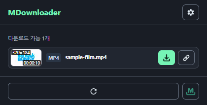
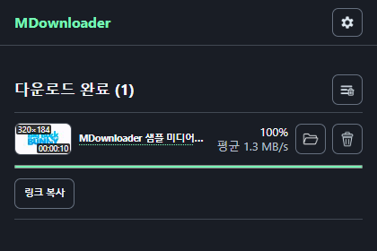

# MDownloader

배포판은 `node tools/build/package-extension.mjs --flavor development|chrome-store`로 원본과 별도의 `artifacts/distributions/<flavor>/extension/`에 생성합니다. 개발판은 기본적으로 Chrome에서도 허용하며 `--block-chrome`은 추가 제한용 빌드 옵션입니다. 개발판은 지원되는 공개 YouTube VOD를 일반 다운로드 UI와 작업 관리자에서 저장합니다. 스토어판은 YouTube provider/vendor를 물리적으로 제외하고 일반 미디어·embed·재생 수집·기존 작업 재개와 전송에서도 고정 차단합니다. 심사 이후 켜는 설정은 없습니다. 상세 범위는 [개발 안내](development.md)와 [검증 기록](verification.md)에 기록합니다.

개발판은 수동 설치판이며, 다른 배포판은 Chrome 웹 스토어판뿐입니다. youtubei.js·SABR·Mediabunny만으로 같은 영상 전체 623초의 수신·병합·실제 개발판 Chrome 저장을 확인했습니다. yt-dlp·FFmpeg 실행 파일과 외부 서버는 사용하지 않았습니다. 일반 클릭의 자동 최고 화질(1080p)과 Shift+클릭의 선택 화질(360p) 모두 같은 영상의 전체 수신·작업 관리자 완료·실제 파일 저장을 확인했습니다. 검증 범위와 제한은 [UI 통합 기록](verification.md#youtube-ui-integration--2026-11-09)에 있습니다. [브라우저 단독 검증](verification.md#browser-only-sabr-completion--2026-11-08)과 [YouTube.js 변경·업데이트 기록](youtube-upstream-changes.md)을 확인하세요.

[English](../README.md) · 한국어


현재 페이지의 영상·오디오를 찾고, 지원되는 스트림을 저장하며, 사이드 패널에서 다운로드를 관리하는 브라우저 확장입니다.

Chrome · Microsoft Edge · Manifest V3 · 기본 시스템 언어 · 미지원 언어는 영어 · 인터페이스 10개 언어

별도의 데스크톱 다운로더 없이 브라우저에서 직접 미디어 파일, 지원되는 비암호화·AES 암호화 HLS, 비암호화 DASH와 지원되는 WebRTC를 저장할 수 있습니다.

[설치](#설치) · [미디어 다운로드](#미디어-다운로드) · [라이브와 현재 구간 저장](#라이브와-현재-구간-저장) · [설정](#설정) · [문제 해결](#문제-해결)

## 설치

1. 프로젝트 폴더를 받아 계속 사용할 위치에 보관합니다.
2. Chrome은 `chrome://extensions`, Edge는 `edge://extensions`를 엽니다.
3. **개발자 모드**를 켭니다.
4. **압축해제된 확장 프로그램을 로드합니다**를 선택하고, `manifest.json`이 있는 **`extension` 폴더**를 지정합니다.
5. 빠르게 열려면 브라우저 확장 메뉴에서 MDownloader를 고정합니다.

확장을 로드하는 데 빌드, npm 설치, 유료 서비스는 필요하지 않습니다. 홈페이지의 스토어 설치 주소는 아직 설정되어 있지 않습니다.

로컬 복사본을 업데이트할 때는 진행 중인 다운로드를 먼저 마친 뒤 파일을 교체하고 브라우저의 확장 관리 화면에서 새로고침합니다.

## 화면

### 감지된 미디어

감지 항목과 썸네일을 확인하고, 지원되는 항목은 미리본 뒤 다운로드합니다.



### 다운로드 관리자

사이드 패널에서 진행 상황과 완료된 작업을 관리합니다.



실제 촬영 화면이며 촬영 당시 버전은 [스크린샷 카탈로그](../website/assets/screenshots/catalog.json)에 있습니다. 이전 촬영본에 없는 현재 기능은 아래 사용법으로 안내합니다.

## 주요 기능

- 현재 페이지의 영상·오디오와 지원되는 HLS·DASH 소스 감지
- 미디어와 브라우저가 허용하는 범위의 썸네일·호버 미리보기
- 관계가 확인된 HLS 화질을 한 항목으로 묶고 화질 선택 제공
- 여러 스트림을 독립적으로 다운로드하고 원본 탭을 닫은 뒤에도 수신 계속
- 지원되는 WebRTC의 백그라운드 수신과 라이브 HLS의 수신 구간 저장
- 원래 다운로드를 계속하면서 별도의 부분 파일 저장
- 진행률·속도 확인, 지원되는 일시정지·재개, 취소, 기록과 완료 파일 관리
- 파일명·저장 위치·언어·진단 설정

지원 언어: English, 한국어, 日本語, 简体中文, Español, Português (Brasil), Français, हिन्दी, العربية, Русский.

## 사용 환경

- Chrome 116 이상 또는 필요한 확장 API를 지원하는 최신 Chromium 기반 Microsoft Edge
- 네트워크 감지와 스트림 다운로드에 필요한 페이지·미디어 서버 접근 권한
- 임시 조각과 최종 파일을 저장할 여유 공간

## 미디어 다운로드

1. 저장할 미디어가 있는 페이지를 열고 재생합니다.
2. MDownloader 아이콘을 누릅니다.
3. 목록에서 항목을 찾고, 가능하면 썸네일이나 호버 미리보기로 확인합니다.
4. **다운로드**를 누릅니다.
5. **다운로드 관리**를 열어 진행 상황을 확인합니다.

항목이 보이지 않으면 미디어 재생, 탐색 바 이동, 페이지 새로고침을 시도합니다. 재생을 시작한 뒤에만 소스가 드러나는 페이지도 있습니다.

## 사이트 접근 권한

1. **옵션 → 고급 → 네트워크 탐지 권한**을 엽니다.
2. **모든 사이트 허용**을 선택하거나 개별 사이트 입력란에 페이지 주소를 넣습니다.
3. 미디어 서버가 별도 주소라면 서버 주소도 넣습니다.
4. 탐지를 허용한 뒤 원래 페이지로 돌아가 다시 재생합니다.

권한은 브라우저에서 관리합니다. 선택적으로 허용한 접근은 같은 옵션 화면에서 해제할 수 있습니다. 로그인 상태, 서버의 접근 규칙, 링크 만료에 따른 제한은 별도로 적용됩니다.

## 스트림 화질 선택

일반 **다운로드**는 지원되는 HLS 중 비트레이트가 가장 높은 화질을 사용하고, WebRTC는 현재 제공되는 서버 프로필로 시작합니다.

1. **Shift를 누른 채 HLS 또는 WebRTC 항목의 다운로드 버튼을 클릭**합니다.
2. 해당 행 아래에 표시되는 해상도·비트레이트 목록에서 선택합니다.
3. 다운로드를 확정합니다. 별도 미디어 서버 권한을 요청하면 확인합니다.

HLS는 지원 화질이 여러 개일 때 선택창을 엽니다. WebRTC는 지원 서버가 실제로 제공한 프로필을 표시하며, 한 개뿐인 프로필도 선택창에서 확인할 수 있습니다. 임의 화질을 만들거나 영상을 리사이즈해 서버 화질처럼 표시하지 않습니다.

## WebRTC 저장

1. 지원 페이지에서 영상을 재생하고 일반 미디어 목록의 **WebRTC** 배지 항목을 찾습니다.
2. **다운로드**를 누르거나 **Shift+다운로드**로 서버 화질을 선택합니다.
3. 관리자의 받은 용량이 증가하기 시작할 때까지 기다립니다. 백그라운드 수신이 시작되면 원본 페이지를 닫거나 이동해도 계속 받습니다.
4. 같은 다운로드 관리자에서 **현재까지 저장**, **중지 및 저장**, **취소**를 사용합니다.

프로젝트에 등록된 시그널링 서비스를 지원하며, 모든 사이트의 MediaStream을 녹화하는 기능은 아닙니다. 별도 녹화 탭은 필요하지 않습니다. 정상 HLS 대체 소스도 WebRTC와 함께 표시할 수 있습니다.

수신기는 실제 원격 영상·음성이 들어온 뒤 녹화를 시작합니다. 브라우저가 지원하면 MP4를 우선 사용하고 WebM으로 대체하며, 녹화 과정에서 재인코딩할 수 있습니다. 연결이 끊기거나 수신이 멈추면 중단 상태와 가능한 부분 파일을 남깁니다. 사용자가 **중지 및 저장**을 요청한 경우에 정상 종료로 처리합니다. 브라우저 종료나 확장 새로고침·제거는 수신을 끝내며, 녹화 자동 복구는 구현되어 있지 않습니다.

## 라이브와 현재 구간 저장

진행 중인 행의 버튼은 왼쪽부터 **취소 → 현재까지 저장 → 중지 및 저장** 순서입니다.

| 동작 | 결과 |
|---|---|
| **취소** | 선택한 작업을 중단하고 완성 전 임시 출력을 버립니다. |
| **현재까지 저장** | 원래 다운로드를 계속하면서 별도 부분 파일과 작업을 만듭니다. |
| **중지 및 저장** | 수신을 끝내고 재생 가능한 구간을 원래 작업에서 저장합니다. |

**중지 및 저장**은 지원되는 HLS·DASH·WebRTC 작업에 표시하며, 저장 가능한 구간을 확보하면 활성화됩니다. HLS·DASH는 새 조각 배정을 멈추고 이미 요청한 조각 처리를 마친 뒤, 첫 누락 조각 앞까지의 연속 영상·음성 구간을 저장합니다. 전체 길이보다 짧게 저장한 일반 스트림에는 부분 파일 접미사를 붙입니다.

**현재까지 받은 구간 저장**은 원래 다운로드를 계속하면서 별도 부분 파일과 기록을 만듭니다. 부분 저장의 취소와 출력은 원래 작업과 독립적이며 원본 파일을 덮어쓰지 않습니다.

- **HLS·DASH:** 쓰기가 끝난 연속 조각과 확보된 오디오 범위를 사용합니다.
- **WebRTC:** 클릭 시점에 로컬 저장소에 기록된 녹화 데이터의 구간을 고정합니다. 미디어를 다시 요청하거나 원래 수신을 중단하지 않습니다.
- **직접 파일:** 원본 서버에서 현재 바이트 범위를 별도로 읽으므로 추가 전송이 발생합니다. 필요한 접근·Range 응답과 완성된 패킷·메타데이터가 확보되어야 합니다.

필수 미디어 정보가 부족하거나 컨테이너·코덱을 재포장할 수 없으면 부분 저장이 실패할 수 있습니다. 부분 작업에 표시되는 오류를 확인해 주세요. 원래 작업의 수신은 별개로 유지됩니다.

## 다운로드 관리

팝업에서 **다운로드 관리**를 열어 진행 중이거나 완료된 작업을 관리합니다.

| 표시 | 의미 |
|---|---|
| 받은 용량·속도 | 하나의 둥근 테두리 박스 안에 용량 위·속도 아래로 표시합니다. 팝업과 글자 크기·박스 크기·색상이 같으며, 용량은 연한 파란색, 속도는 회색입니다. |
| 진행 바 | 행 아래의 얇은 막대입니다. 전체 크기를 알면 진행 비율을, 모르면 미정 진행 상태를 표시합니다. |
| 취소됨 | 팝업과 관리자 모두 민트색 글자를 둥근 테두리 박스 안에 표시합니다. |

- 브라우저가 지원하는 직접 파일 작업은 일시정지하거나 재개할 수 있습니다.
- 선택한 진행 중 작업을 다른 작업과 독립적으로 취소할 수 있습니다.
- 완료된 브라우저 다운로드는 **폴더에서 보기**로 찾을 수 있습니다.
- 선택 폴더에 직접 저장한 완료 작업에도 같은 폴더 아이콘이 표시됩니다. 이 경우 확장의 저장 폴더 화면에서 파일 목록과 저장 파일을 확인하고 브라우저로 열 수 있습니다. Chrome 다운로드 기록이 있는 작업은 기존 Windows 탐색기 연결을 유지합니다.
- 행의 링크 복사·툴팁을 통해 원본 주소나 전체 파일명을 확인할 수 있습니다.
- 일반 삭제는 목록의 기록만 지우며 파일은 남깁니다.
- 해당 동작이 가능한 완료된 브라우저 다운로드에서 **Shift를 누른 채 삭제**하면 파일도 지웁니다.
- 섹션 비우기는 해당 섹션의 기록을 지우며 저장된 미디어 파일은 삭제하지 않습니다.

아이콘에 마우스를 올리면 동작 이름을 확인할 수 있습니다. 키보드와 보조 기술에서도 같은 접근성 이름을 제공합니다.

## 설정

| 설정 | 용도 |
|---|---|
| 표시 언어 | 시스템 언어 또는 10개 언어 중 하나를 선택합니다. 기본 대체 언어는 영어입니다. |
| 페이지 제목을 파일 이름으로 사용 | 현재 페이지 제목과 원래 파일명을 연결합니다. 기본값은 켜짐입니다. |
| 파일명에 날짜와 시간 포함 | 다운로드 시작 현지 시각을 붙입니다. 기본값은 켜짐입니다. |
| 다운로드 위치 | 브라우저 기본 폴더의 하위 경로를 지정하거나, 지원되는 환경에서 폴더를 선택합니다. **위치 저장**은 선택한 폴더를 유지하고, **기본 위치 사용**으로 명시적으로 초기화합니다. |
| 사이드뷰 상단에 감지된 미디어 표시 | 다운로드 목록 위에 현재 탭의 미디어를 표시합니다. |
| 디버깅 모드 | 작업 진단 탭을 별도로 엽니다. |
| 다운로드 로그 기록 | 문제 확인용 결과 로그를 제한된 개수만 기기에 보관합니다. |
| 상세 디버그 로그 켜기 | 확장 콘솔에 안전한 단계 코드·소요 시간·수치를 표시합니다. 기본값은 꺼짐입니다. |

페이지 제목·날짜·시간을 사용하는 기본 설정의 파일명 예시는 다음과 같습니다.

| 소스 | 저장 이름 예시 |
|---|---|
| 원래 파일명이 있음 | `페이지제목_원래파일명_2026-11-08_15-04-06.mp4` |
| 원래 파일명이 없음 | `페이지제목_2026-11-08_15-04-06.mp4` |
| 원래 파일명과 페이지 제목이 모두 없음 | `2026-11-08_15-04-06.mp4` |

이름과 현지 시작 시각은 작업 등록 때 고정합니다. 확장자는 실제 미디어 형식에 맞추며, WebM으로 저장하면 `.webm`을 사용합니다. 원래 파일명이 없는 스트림에 `MDownloader-`, `playback`, 임의의 WebRTC 이름을 덧붙이지 않습니다. 사용자가 명시적으로 선택한 페이지 제목·날짜·시간 설정은 유지합니다. 부분 파일에는 별도 부분 저장 접미사를 붙입니다.

## 지원 미디어

| 종류 | 지원 범위 |
|---|---|
| 직접 파일 | MP4·WebM·MOV·MKV·MP3·M4A·WAV·FLAC·OGG 계열 등을 포함한 HTTP(S) 영상·오디오. 원래 형식으로 저장합니다. |
| HLS | 지원되는 비암호화 또는 전체 조각 AES 암호화 MPEG-TS·fMP4. H.264·AAC와 지원되는 fMP4 AV1 등을 재인코딩 없이 재포장합니다. |
| DASH | 지원되는 정적 단일 Period fMP4 표현을 재인코딩 없이 재포장합니다. |
| 라이브 | 완성 조각의 경계를 확인할 수 있는 지원 라이브 HLS. |
| WebRTC | 지원 시그널링 스트림의 독립 백그라운드 수신과 MP4·WebM 저장. 수신 연결 후 원본 페이지를 닫아도 지속합니다. |

HLS 암호화는 재생목록에서 정상 접근 가능한 `identity` 키를 제공하는 `AES-128`, `AES-256`(CBC), `AES-256-CTR`, `AES-256-GCM`을 지원합니다. 키 교체, 명시적 IV, 조각 순번으로 계산하는 IV를 자동 처리합니다. 별도 설정 없이 기존 다운로드 버튼을 사용하시면 됩니다. 암호화된 저지연 재생목록은 완성된 부모 조각을 사용합니다.

| 한도 | HLS·DASH | WebRTC |
|---|---|---|
| 작업당 임시 미디어 | 16GiB | 2GiB |
| 개별 미디어 자원 | 32MiB | 녹화 조각별 제한 적용 |
| 작업당 조각 수 | 트랙을 합해 5,000개 | 녹화 조각·버퍼 제한 적용 |

브라우저의 실제 저장 공간 한도가 더 작을 수 있습니다. DRM 라이선스 방식, 샘플 암호화(`SAMPLE-AES`·`SAMPLE-AES-CTR`), 암호화 DASH, 라이브 DASH, 알 수 없는 시그널링, 지원하지 않는 코덱·구조, 전달에 리디렉션이 필수인 소스, 미완성 저지연 조각 그룹은 지원 범위에서 제외됩니다. 접근이 거부되거나 잘못된 암호화 키로는 저장할 수 없습니다. 기술 경계는 [개발 문서](development.md)를 참고해 주세요.

## 문제 해결

**목록에 아무것도 보이지 않습니다.**

재생·탐색 바 이동·새로고침과 페이지·미디어 서버 권한을 확인합니다. 카드 호버용 미리보기나 광고는 본편 목록에서 제외될 수 있습니다. 소스가 감지되었다고 모든 주소의 다운로드가 가능한 것은 아닙니다.

**썸네일이나 미리보기가 실패합니다.**

다른 출처의 프레임, 보호된 소스, 캡처 API에 브라우저 제한이 있을 수 있습니다. 미리보기 실패 자체가 다운로드 실패를 뜻하지는 않습니다. 원본 페이지의 재생 상태도 확인합니다.

**권한 오류나 HTTP 오류가 발생합니다.**

페이지와 미디어 서버 접근, 로그인 상태, 링크 만료 여부를 확인합니다. 복사한 주소가 다른 환경에서도 계속 유효하다고 가정하지 말고 원본 페이지의 소스를 갱신합니다.

**부분 파일을 저장할 수 없습니다.**

데이터를 더 받은 뒤 시도합니다. 직접 파일은 추가 범위 요청이나 끝부분 메타데이터가 필요할 수 있고, 일부 미디어는 받은 부분만으로 안전하게 묶을 수 없습니다.

**진단 정보가 필요합니다.**

옵션에서 결과 로그나 상세 디버그 로그를 켜고 문제를 재현한 뒤 끕니다. 상세 로그에는 원본 URL·헤더·쿠키·토큰·IP·파일 경로·오류 원문과 스택을 기록하지 않습니다. 다른 화면에 표시되는 브라우저·외부 라이브러리 메시지는 자체 문구를 포함할 수 있습니다.

**WebRTC가 감지되지만 시작되지 않습니다.**

연결 관측기가 초기 시그널링을 확인할 수 있도록 원본 페이지를 새로고침하고 재생합니다. 페이지·미디어 서버 접근 권한도 확인합니다. 지원하지 않는 시그널링 서비스나 없는 서버 프로필은 임의 화질로 대체하지 않습니다.

## 제거

브라우저 확장 관리 화면에서 MDownloader를 제거합니다. 확장을 제거해도 이미 다운로드한 미디어 파일은 삭제하지 않습니다.

## 개발과 검증

`extension/`을 브라우저에서 직접 로드합니다. 핵심 검사는 Node.js 24에서 실행합니다.

```powershell
node --test tests/*.test.mjs
node tools/checks/audit-localization.mjs
node tools/build/build-page-policy.mjs --check
node --expose-internals tools/checks/verify-project.mjs
```

폴더별 책임과 도구는 [개발 문서](development.md), 검사로 확인하는 범위와 설치 브라우저에서 별도로 확인할 범위는 [검증 문서](verification.md)를 참고해 주세요.

## 외부 구성 요소

Mediabunny를 MPL 2.0으로 포함합니다. [외부 구성 요소 고지](../THIRD_PARTY_NOTICES.md)와 포함된 라이선스를 확인해 주세요. MDownloader 원본 코드의 별도 라이선스는 아직 지정되어 있지 않습니다.

## 개발 후원

[Ev-Cabinet에서 개발 후원하기](https://evilack.github.io/donate.html)

개발판 YouTube 다운로드는 제공되는 원본 자막도 받아 MP4 자막 트랙으로 병합합니다. 같은 영상의 영어·한국어 자동 자막을 실제 저장하고 전체 문구·시간 정보와 영상·음성 보존을 확인했습니다. 제공된 자막의 수신·병합에 실패하면 자막을 빼고 저장 완료로 처리하지 않습니다. [자막 검증 기록](verification.md#youtube-captions--2026-11-09)을 확인하세요.

개발판의 **설정 → 다운로드 설정 → 자동 생성 자막 포함**에서 YouTube 자동 생성 자막을 포함하거나 제외할 수 있습니다. 기본값은 포함이며, 끄면 직접 등록된 자막만 저장합니다. 변경은 새 다운로드에 적용됩니다. [포함·미포함 검증](verification.md#automatic-caption-option--2026-11-09)을 확인하세요.

완료 항목의 폴더 아이콘을 **Shift를 누른 채 클릭**하면 저장된 파일을 브라우저 새 탭에서 재생합니다. 일반 클릭은 탐색기에서 보기를 요청합니다. 선택 폴더에 직접 저장한 파일의 탐색기 연결은 [Windows 연결 도우미](../native/explorer/README.md) 등록과 최초 1회 폴더 연결이 필요하며, 이번 검사에서 사용자 승인 후 등록과 Chrome 통신을 확인했으며, 실제 탐색기 화면은 아직 검증하지 않았습니다. 기존 폴더 목록 대체 페이지는 제거했습니다.

개발판은 YouTube 진행 중 라이브 수신과 예약방송 시작 대기를 지원합니다. 예약방송을 등록하면 같은 영상의 시작 여부를30초마다 확인하고, 시작 후 제공되는 AVC/AAC 화질로 자동 수신합니다. 라이브는 수신을 시작한 시점부터 저장하며 중간 저장과 저장하고 종료를 사용할 수 있습니다. Chrome을 켜 두어야 하며, 브라우저 종료·컴퓨터 절전 중 수신은 지원하지 않습니다. 스토어판의 YouTube 제외는 유지합니다. 실제 예약방송 송출·시작 전환 검증은 사용자 요청에 따라 보류했습니다.
