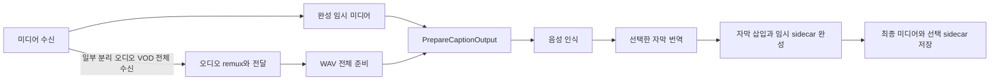
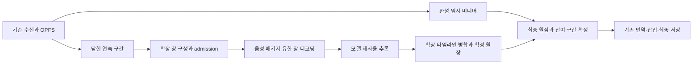

# 다운로드와 음성 자막 병행 처리 가능성·설계

> **범위 정정:** C 분류는 작성자의 도입 순서 제안이며 사용자 승인된 제외 범위가 아닙니다. 이전 A/B 정적 승인은 해당 구현 부분의 기술 검토에 한정됩니다. 전체 요청의 미구현 항목을 다시 대조하고 라이브·수신 구간 병행을 포함해 설계·구현을 이어갑니다.

작성일: 2026-11-10, 한국 시간. 상태: **A/B 소스 구현과 독립 정적 리뷰·지적 수정을 반영했으며 최종 전체 명세/코드 품질 Approved(소스 기준), 실행 검증은 금지되어 미실행**. 최초 조사 이후 사용자가 구현을 명시적으로 요청했으며 테스트 금지는 유지합니다. 최종 변경과 실행 인수의 구별은 [정적 리뷰 기록](../../concurrent-captions-static-review-2026-11-10.md)을 따릅니다.

구현 작업은 [구현 계획서](../plans/2026-11-10-concurrent-download-speech-captions.md)를 따릅니다. 이 문서는 현재 코드의 관찰, 외부 사례, 설계 제안을 구분합니다.

## 1. 결론과 조사 범위

기술적으로 가능하다고 판단합니다. 그러나 현재 코드는 다운로드와 오디오 준비를 일부 겹치며, 음성 인식 자체는 완성된 임시 미디어의 출력 파이프라인에서 시작합니다. 모든 다운로드에 불완전 파일을 ffmpeg 입력으로 연결하는 방식으로 확대할 수는 없습니다.

권장 도입 순서는 다음과 같습니다.

1. **A: 오디오 전체가 먼저 준비된 VOD의 조기 인식.** 기존 HLS/DASH 분리 오디오와 YouTube SABR의 준비 경로를 재사용합니다. 영상 다운로드가 끝나기 전에 인식을 시작하되, 최종 미디어의 시각 기준이 확정된 후 결과를 재정렬합니다. 가장 작은 변경으로 실질적인 병행 효과를 얻을 후보입니다. 오디오가 먼저 끝나는 입력에서만 효과가 있습니다.
2. **B: HLS VOD의 연속 확정 구간 단위 추출·인식.** 다운로드가 완료된 세그먼트의 연속 구간을 독립적으로 읽을 수 있는 유한 미디어 창으로 만들고, 닫힌 창만 네이티브로 전달합니다. 먼저 단일 코덱·타임라인·AAC 오디오를 대상으로 제한합니다. 분리 오디오에서 시작하고 동일 트랙 TS의 오디오까지 확장합니다.
3. **C: YouTube SABR의 부분 fMP4, 일반 파일, 라이브·녹화.** 별도 진입 조건이 필요한 후속 범위입니다. A/B 완료를 C 지원 완료로 보고하지 않습니다. 초기에는 기존 완성 미디어 후처리를 유지합니다.

이 결론은 구현 가능한 구조에 대한 판단입니다. 처리 속도 향상률, CPU/GPU 사용량, 사용자 영상의 정확도, Windows/macOS 설치본의 동작은 확인하지 않았습니다. 테스트·구문 검사·브라우저 실행·네이티브 프로브·설치·실제 다운로드·모델 다운로드·인식·번역 API 호출을 수행하지 않았습니다. 소스·설정·문서 읽기, 공식 자료와 upstream 이슈 조사, 문서 작성만 했습니다.

조사 시작 시 작업 폴더는 `E:\Project\MDownloader`, 브랜치는 `codex/youtube-distribution-probe`였으며 `git status --short`에 359개 항목이 있었습니다. 이후 다른 작업에 의해 바뀔 수 있는 관찰값입니다. 조상 경로와 저장소·문서 하위에서 별도 `AGENTS.md` 파일은 발견하지 못했으며, 채팅에 제공된 사용자 규칙을 적용했습니다. 다른 작업의 변경을 수정·되돌리거나 작업트리·커밋을 만들지 않았습니다.

## 2. 현재 소스에서 확인한 경로

아래 위치와 행 번호는 조사 당시 작업 중 소스 기준이며 커밋의 재현성을 보장하는 고정 링크가 아닙니다. 후속 구현자는 함수 이름으로 다시 찾아야 합니다.

| 소유 경로 | 현재 동작과 한계 |
| --- | --- |
| `extension/jobs.js:39` `RegisterMediaJob` | 인식 설정을 작업에 스냅샷하고 신규 자막 작업에 `captionPipeline:'staged'`를 부여합니다. `local-captions-settings.js:33`은 모델·형식·인식 설정을 복사·동결합니다. |
| `extension/lib/stream-transfer.js` `DownloadTrackResources` | 파일을 닫은 뒤 `Committed`에 등록합니다. 다운로드 완료 순서는 재생 순서와 다를 수 있습니다. `Track.saved`는 요청 준비 때 먼저 추가되므로 수신 완료의 근거가 아닙니다. |
| 같은 파일의 `AudioReady` 발행 조건 | 첫 영상 세그먼트와 init이 저장되고, 분리 오디오 트랙이 VOD이며, 모든 오디오 세그먼트/init이 저장되고, 오디오에 discontinuity가 없을 때 **한 번** 발행합니다. 전체 오디오 준비 콜백이지 구간별 콜백이 아닙니다. |
| `extension/hls-runner.js:493` | VOD에만 `audioReady`를 연결하고 `RemuxCaptionAudio` → 닫힌 `caption-audio.m4a` → `PrepareCaptionBlob`를 실행합니다. 별도 오디오가 없으면 이 조기 경로가 열리지 않습니다. 예외는 `captionPrepared=false`로 처리합니다. |
| `extension/lib/hls-remux.js:107` | HLS 오디오를 첫 영상 참조와 함께 remux하여 공통 시각 기준을 보존합니다. 함수명과 달리 영상 참조 경로에는 작은 영상 트랙이 포함될 수 있고 네이티브가 오디오만 선택합니다. 현재 오디오는 AAC로 제한됩니다. |
| `extension/features/youtube/sabr.js` `ReceiveSabrTracks` | 독립 영상·오디오 스트림을 순서대로 씁니다. `trackReady('audio')`는 비라이브 오디오 reader가 EOF에 도달했을 때 호출합니다. 모든 후속 트랙 길이 검사가 끝난 전역 성공 신호는 아닙니다. |
| `extension/features/youtube/runner.js:116` | 비라이브 오디오 전체 준비 시 `RemuxCaptionAudioFile(Store.snapshot().audio)` → `PrepareCaptionBlob`를 시작합니다. AAC만 통과하며 라이브는 제외합니다. |
| `extension/features/youtube/track-store.js:3` | 닫힌 네트워크 청크 파일들의 Blob 목록을 제공합니다. **네트워크 청크 경계와 완전한 MP4 box/샘플 경계는 동일하지 않습니다.** |
| `extension/lib/local-captions-runner.js:8` | 완성 File 전체를 192KiB씩 `begin/append`로 전달한 뒤 `prepare`하고 `audio-ready`를 기다립니다. `recognize`를 호출하지 않습니다. |
| `native/captions/host.py:105,119` | `prepare_audio`가 끝나 `audio-complete.json`을 만든 후 인식합니다. `start`도 preparation future 완료를 기다립니다. audio pool과 recognition pool은 각각 worker 1개지만 제출 큐 자체의 상한은 별도 없습니다. |
| `native/captions/engine.py:414` | ffmpeg 완료 입력에서 mono/16kHz/PCM16 WAV를 30초씩 만듭니다. `aresample=async=1:first_pts=0`으로 선행 공백을 보존하려고 합니다. 파일당 크기, PCM 총량 2GiB, 가용 공간 256MiB 하한을 검사합니다. |
| `native/captions/engine.py:436` | 준비된 WAV 목록을 한 번 확정하고 순서대로 인식합니다. `completed/total`은 파일 개수입니다. Faster-Whisper 모델은 이 호출 안에서 한 번 로드하고 파일마다 재사용합니다. |
| `native/captions/cpp-worker.py` 및 `engine.py:451` | whisper.cpp CLI 또는 바인딩 자식 프로세스를 **30초 파일마다 새로 실행**합니다. 현재 반복 호출 간 모델 재사용이 없습니다. `conditionOnPreviousText`도 각 파일 내부에 한정됩니다. |
| `extension/lib/caption-output-pipeline.js:33` | `mediaReady:true` → 필요 시 오디오 준비 → `recognize` → recognized 대기 → VTT 읽기 → 생성 번역 → 임시 sidecar → 자막 삽입/저장 단계로 진행합니다. 현재 인식 시작 게이트입니다. |
| `extension/hls-runner.js:175` `SaveMediaFile` | 기존 웹 자막 번역, 음성 결과, 컨테이너 삽입을 거쳐 최종 미디어를 저장합니다. 생성/번역/삽입 실패 시 staged 자막 작업의 원본 대체 저장을 허용하지 않는 경로입니다. |
| `extension/hls-runner.js:541` `DownloadDirectToFolder` | 음성 자막을 켜면 일반 파일도 임시 `source.media` 수신을 마친 뒤 공통 출력 경로에 들어갑니다. 현재 수신 중 추출 훅은 없습니다. |
| `extension/lib/webrtc-transfers.js:6`, `webrtc-recording.js:10` | 녹화 저장과 스냅샷은 공통 `SaveMediaFile`로 연결됩니다. MediaRecorder 데이터 조각이 개별 디코딩 가능한 파일이라는 계약은 없습니다. |
| `extension/lib/local-captions-service.js:27,134` | background가 네이티브 연결, 작업 상태, `captionStage` 송신자 검증을 소유합니다. staged의 recognized 이벤트는 레거시 `SaveResults`를 실행하지 않습니다. |
| `extension/lib/local-captions-runner.js:42` | 현재 `CaptionTiming`은 인식 **전** 저장한 offset을 최종 미디어 시작에 맞춥니다. 이미 인식한 결과를 다시 쓰는 기능은 없습니다. 조기 인식 후 이 함수만 호출하면 정렬이 해결된다고 가정하면 안 됩니다. |
| `native/captions/host.py:128` 이후 | 인식 완료 후 PCM과 완료 마커를 지우고 압축 입력/결과는 재시도용으로 최대 24시간 보존합니다. 새 창 수명을 이 동작과 충돌시키면 안 됩니다. |
| `extension/lib/committed-snapshot.js:4` | init을 포함해 닫힌 **연속 prefix**만 사용하고 분리 A/V 공통 구간을 제한합니다. 새 음성 경로도 같은 확정 규칙을 재사용해야 합니다. |
| `extension/lib/transfer-snapshots.js:7`, `stream-workspaces.js:8` | 스냅샷은 별도 작업/취소 소유권이고 원본 파일 수명을 빌립니다. 새 offscreen 시작 시 OPFS 작업 폴더를 정리하므로 현재 구조로 브라우저 재시작 후 원본 창 재개를 보장할 수 없습니다. |

현재 경로를 요약하면 다음과 같습니다.

### 진행률·취소·출력에서 주의할 현재 계약

- `caption-job-progress.js:15`는 `mediaReady`가 없어도 queued/recognizing/recognized이면 공통 바를 전환합니다. 조기 인식만 추가하면 다운로드 진행률을 가리는 회귀가 생깁니다. `row-presentation.js:83`의 최종 override와 `metrics.js:55`도 함께 고려해야 합니다.
- `job-row.js:236`의 렌더 캐시 키는 phase/error/outputs 위주입니다. 같은 recognizing phase에서 새 수치가 바뀔 때 실제 갱신되는지 보장하도록 새 진행 필드도 비교 대상에 넣어야 합니다.
- 현재 `Track.saved`에는 duration/discontinuity/init/path만 남고 원본 sequence·range·PTS가 모두 보존되지 않습니다. B의 descriptor에는 원본 resource metadata를 추가로 연결해야 하며 기존 snapshot 객체에 없는 정보를 이미 있는 것처럼 사용하지 않습니다.
- 기존 취소는 `jobs.js` `ControlJob` → HLS/YouTube/녹화/direct controller로 전달되며 `captionPipelineCanceled`, `jobsChanged`의 네이티브 cancel도 있습니다. 조기 인식에는 최종 출력 함수가 설치하는 abort listener보다 이른 취소 연결이 필요합니다.
- `generated:true`는 `trackIds`와 함께 존재할 수 있습니다. 생성 번역 여부는 `GeneratedTranslationRequested`, 병합은 `MergeGeneratedSubtitleStatus`를 재사용합니다. 원래 자막 count/completed/unavailable/errorCount를 새 생성 결과로 덮어쓰지 않습니다.
- `PrepareCaptionOutput`의 생성 트랙은 현재 최종 미디어 시간 기준입니다. 웹 자막의 `timeBase:'media'` 보정과 혼합하여 offset을 두 번 빼지 않아야 합니다.
- 폴더 직접 저장은 `WriteToPickedFolder`가 파일 하나씩 확정합니다. 브라우저 미디어 저장 뒤 native `saveResult`로 sidecar를 저장하는 경로도 있습니다. 여러 파일 전체의 원자적 저장은 현재 보장되지 않습니다.

## 3. 입력 유형별 적용 범위

| 입력 | 현재 다운로드 중 처리 | A: 전체 오디오 조기 인식 | B/C: 구간 병행 조건과 초기 결정 |
| --- | --- | --- | --- |
| HLS TS, 영상·오디오 같은 트랙 | 조기 오디오 준비 없음 | 해당 없음 | B에서 닫힌 연속 TS와 PAT/PMT·AAC config·PTS가 읽히는 유한 창을 대상으로 추가. 패킷 경계 확인만으로 오디오 디코딩 성공을 보장하지 않음. |
| HLS TS/ADTS 분리 오디오 VOD | 오디오 전체/init + 첫 영상 준비 시 remux/WAV 준비 | 지원 후보 | B의 첫 구간 대상. Packed Audio의 타임스탬프/ID3 및 영상 기준을 복원할 수 없는 경우 후처리. |
| HLS fMP4 분리 오디오 VOD | 같은 전체 오디오 경로, AAC 조건 | 지원 후보 | 해당 init 및 완전한 moof/mdat·샘플·decoder config 확인 후 B. init 변경은 별도 epoch이며 초기 지원에서 제외. |
| HLS fMP4 영상·오디오 같은 트랙 | 전체 수신 후 처리 | 해당 없음 | 완전한 fragment 단위 파싱·A/V 선택이 필요하므로 B 후반 후보. 확장자 m4s만으로 활성화 금지. |
| 일반 DASH VOD | `ResolveDash`가 로컬 HLS 형태의 트랙으로 전달. 분리 오디오 전체 조기 준비 가능 | AAC 및 현재 remux 지원 조합에 한해 후보 | SegmentBase/sidx, timescale, presentationTimeOffset, init 및 실제 PTS 매핑 확인 필요. 첫 B 릴리스는 DASH 구간 모드 제외. |
| YouTube VOD/SABR | 오디오 reader EOF 후 AAC remux/WAV 준비 | 지원 후보 | C에서 트랙 store의 닫힌 bytes를 box/샘플 경계까지 판별한 뒤 적용. `trackReady`를 구간 알림처럼 사용하지 않음. 현재 AVC/AAC 최종 remux 제한·배포 정책 유지. |
| 일반 MP4, moov가 뒤 | 완성 `source.media` 후 준비/인식 | 후처리 | 다운로드 prefix만으로 sample table이 없음. 네이티브에 불완전 파일을 주지 않음. 사전 tail/range 추가 수신은 초기 범위 밖. |
| 일반 MP4, faststart 또는 fMP4 | 현재는 완성 파일 후 처리 | 후처리 | 메타데이터가 앞에 있어도 필요한 미디어 샘플과 연속 바이트가 확보되어야 함. C에서 검증된 sample index/fragment parser를 만들기 전에는 후처리. |
| 일반 WebM/분리 Opus | 현재 조기 remux는 AAC 제한, 완성 입력은 ffmpeg 처리 후보 | 후처리 | EBML 헤더·트랙·완전 Cluster/Block, CodecDelay/SeekPreRoll, Opus 프리롤 보존 필요. 현재 AAC m4a 래퍼에 넣을 수 없음. |
| HLS 라이브/DVR | 전체 오디오 조기 준비 제외 | 제외 | C: 총길이 미정, 슬라이딩 윈도·누락·불연속·33bit PTS wrap과 녹화 원점 고정 필요. 우선 기존 finish 후 유한 미디어 처리. |
| YouTube 라이브/예약/방송 종료 후 DVR | live이면 조기 준비 제외, postLive는 실제 resolved.live/트랙 구조에 따라 판정 | 순수 유한 VOD 계약을 만족할 때만 | C. 예약 대기 시간을 오디오 길이에 포함하지 않음. 이름/페이지 상태 대신 실제 스트림 플래그와 완료 검사를 사용. |
| WebRTC/MediaRecorder 녹화·재생 캡처 | 녹화 끝/부분 미디어 후 공통 후처리 | 제외 | C. dataavailable Blob의 독립 디코딩 가능성 보장 없음. 초기에는 녹화 종료 후 처리. 실시간 AudioWorklet 분기는 새 캡처 정책이므로 별도 범위. |
| 실행 중 snapshot 저장 | snapshot 자막 생성은 명시적으로 건너뜀 | 기존 동작 유지 | 부모 인식 상태를 변경하지 않음. 동시 snapshot에 생성 자막을 넣는 기능은 별도 명시 범위로 남김. |

암호화 HLS는 기존 `HlsDecryptor`가 처리한 **로컬 평문 확정 파일**만 소비합니다. 키·쿠키·원격 URL을 음성 런타임에 새로 전달하지 않습니다. 현재 지원 밖 DRM/코덱/매니페스트를 이 기능을 이유로 지원한다고 표시하지 않습니다.

## 4. 외부 근거와 적용 한계

2026-11-10에 아래 원문을 읽었습니다. upstream master 문서는 설치 버전과 다를 수 있으며 이슈의 사용자 보고를 현 프로젝트의 재현 결과로 취급하지 않습니다.

| 근거 | 확인한 내용 | 이 설계에서의 판단 |
| --- | --- | --- |
| [Faster-Whisper 공식 README](https://github.com/SYSTRAN/faster-whisper#usage) | 결과 generator를 순회해야 실제 인식이 진행됨. VAD, 단어 타임스탬프, 모델 객체 재사용 API가 있음. | 결과가 점진 반환된다는 사실은 입력 스트림도 무한히 추가할 수 있다는 뜻이 아님. 유한 오디오 창 호출이 필요. |
| [고정 v1.2.1 transcribe 소스](https://github.com/SYSTRAN/faster-whisper/blob/v1.2.1/faster_whisper/transcribe.py#L825) | ndarray가 아니면 먼저 `decode_audio`를 호출하고 전체 배열 길이를 사용함. | 현재 `faster-whisper==1.2.1`에 맞춰 유한 입력을 채택. growing file을 그대로 transcribe하는 설계 배제. |
| [whisper.cpp 공식 stream 예제](https://github.com/ggml-org/whisper.cpp/blob/master/examples/stream/README.md) | 마이크 오디오를 반복 인식하는 예제와 sliding VAD mode가 있음. | 파일 전송 프로토콜·완성 자막 병합·본 프로젝트 바인딩 호환성을 제공하지 않음. SDL2/마이크 예제를 다운로드 파이프라인으로 직접 대체하지 않음. |
| [WhisperStreaming 연구 구현](https://github.com/ufal/whisper_streaming), [연구 논문](https://aclanthology.org/2023.ijcnlp-demo.3/) | local agreement와 적응 지연을 사용한 스트리밍 인식 연구·현장 시연을 보고. 저장소는 후속 SimulStreaming도 안내함. | 스트리밍이 가능하다는 사례이며 성능 수치를 가져오지 않음. 실시간 자막 표시가 목표가 아니므로 새 프레임워크 도입보다 확정 창 처리 선택. |
| [Faster-Whisper #1127](https://github.com/SYSTRAN/faster-whisper/issues/1127) | 무음 창과 VAD의 언어 감지 오류 보고. 2024-11-12 master에서 해결됐다는 보고 후 종료됨. | 현재 버전의 미해결 버그로 주장하지 않음. 무음 창을 진도에 포함하고 언어를 고정하지 않는 회귀 시나리오의 근거. |
| [Faster-Whisper #230](https://github.com/SYSTRAN/faster-whisper/issues/230) | 음악/무음 앞부분과 VAD 복원 타임스탬프 불일치에 대한 사용자 보고. | VAD 전후 좌표 복원과 실제 A/V 동기 검토 필요. 모든 VAD 결과가 잘못된다는 근거가 아님. |
| [whisper.cpp #1056](https://github.com/ggml-org/whisper.cpp/issues/1056) | rolling 출력의 반복 줄을 파일에 누적할 때 중복이 발생한다는 사용자 보고와 maintainer 설명. | stdout 줄을 완성 SRT에 단순 append하는 방식 배제. 결과 ID·revision·확정 경계 필요. |
| [FFmpeg MOV/MP4 fragmentation](https://ffmpeg.org/ffmpeg-formats.html#Fragmentation) | 일반 MP4의 메타데이터 위치와 fragmented MP4의 중단 시 디코딩 가능성·호환성 차이 설명. | 완전 fragment와 init이 있는 경우의 근거. 잘린 moof/mdat·일반 미완성 MP4가 동작한다는 근거가 아님. |
| [FFmpeg file/pipe 프로토콜](https://ffmpeg.org/ffmpeg-protocols.html#file), [pipe](https://ffmpeg.org/ffmpeg-protocols.html#pipe) | file follow 및 종료 조건, pipe I/O와 seek 제약 설명. | `follow=1`만 추가하면 포맷 구조나 완료 통지가 해결되지 않음. MOV의 seek 주의 문구는 특히 출력 설명이므로 모든 MP4 입력 금지로 확대하지 않음. |
| [RFC 8216 §3.3, §4.3.2.3–5](https://datatracker.ietf.org/doc/html/rfc8216#section-3.3) | fMP4 init과 MAP, discontinuity 및 sequence/타임스탬프 동기 계약. | 초기에는 안정된 epoch만 지원. EXTINF 합계만으로 다른 트랙의 절대 PTS를 추정하지 않음. |
| [pywhispercpp v1.5.1](https://github.com/absadiki/pywhispercpp/blob/v1.5.1/pywhispercpp/model.py), [v1.2.0](https://github.com/absadiki/pywhispercpp/blob/v1.2.0/pywhispercpp/model.py) | 모델 인스턴스로 반복 transcribe 가능. 생성자 context/GPU 옵션은 버전별 차이가 있음. | 지속 worker 가능성의 정적 근거. Intel Mac 1.2.0의 미지원 GPU 설정을 숨기지 않음. 실제 바이너리/메모리 해제는 향후 확인. |
| [Chrome native messaging](https://developer.chrome.com/docs/extensions/develop/concepts/native-messaging) | 프레임 JSON, 호스트→확장 최대 1MB, connectNative 프로세스 수명 설명. | 기존 192KiB raw chunk와 ACK 재사용. 원시 대용량 PCM을 단일 메시지로 보내지 않음. |
| [Chrome worker 수명](https://developer.chrome.com/docs/extensions/develop/concepts/service-workers/lifecycle), [offscreen](https://developer.chrome.com/docs/extensions/reference/api/offscreen) | worker 전역 상태의 영속성 제한과 offscreen의 runtime 메시지 경계. | offscreen은 OPFS/전송 소유, background는 검증·영속 상태·네이티브 연결 소유를 유지. 네이티브 port가 살아 있어도 장애 복구 계약은 필요. |
| [Mediabunny 읽기 가이드](https://mediabunny.dev/guide/reading-media-files) | lazy reading, 파일/트랙 메타데이터와 패킷 접근 제공. | 현재 번들 `mediabunny-1.65.2.mjs` API를 직접 기준으로 구현. 최신 문서의 새 streaming 기능이 설치 번들에 있다고 가정하지 않음. |

현재 의존성은 Faster-Whisper 1.2.1, av 15.1.0(Windows), imageio-ffmpeg 0.6.0, pywhispercpp 1.5.1 및 Intel Mac 1.2.0입니다. 실제 ffmpeg/whisper CLI 버전·GPU 가용성은 설치 설정에 따라 달라지며 실행 확인하지 않았습니다.

## 5. 후보 비교와 권장 구조

| 후보 | 변경량·장점 | 제약·결정 |
| --- | --- | --- |
| 완성 오디오 조기 인식(A) | 기존 준비 경로·start/status·최종 출력 재사용, 구간 경계 알고리즘 변경 최소 | 오디오가 전체 미디어보다 먼저 끝날 때만 이득. offset 최종화·취소·진행률 수정 필요. **먼저 도입**. |
| 닫힌 유한 창 파이프라인(B) | 수신 초반부터 추출/인식 가능, ACK·캐시·재시도·자원 상한 제어 가능 | PTS·중복 문장·디코더 프리롤 처리 추가. **일반 병행의 권장안**. |
| 지속 ffmpeg pipe/growing file | 스트림 친화 입력에서는 프로세스/리샘플러 재사용 가능 | JSON native 채널은 별도이고 OPFS는 native 경로가 아님. EOF/프레이밍·seek·중단·코덱 변경 복잡. 초기안에서 제외. |
| 누적 prefix 전체를 반복 인식 | 연결은 단순해 보임 | 누적 재처리 비용 증가, 문맥/출력 변동, 최종 전체 재인식 유발. 제외. |
| 브라우저 WebCodecs/PCM·새 스트리밍 엔진 | 일부 입력에서 경량 추출 가능 | 브라우저 코덱 지원·리샘플·정렬을 새로 관리하고 기존 두 엔진 설정 보존 비용 큼. 현 범위에서 제외. |

권장 구조는 확장앱이 대상 판정·창 구성·타임라인·추론 제출 순서·병합·fallback·번역·최종 저장을 소유하는 구조입니다. 네이티브 음성 패키지는 유한 창 디코딩/추론, 파일 및 프로세스 격리, 자원 제한 집행, 결과 보관만 수행합니다. 공통 도우미에 사이트/다운로드/번역 정책을 추가하지 않습니다.

### 5.1 A의 필수 변경

`PrepareCaptionBlob`가 성공한 비라이브 작업에서 조기 `recognize`를 요청합니다. `mediaReady`는 올리지 않습니다. `PrepareCaptionOutput`은 이미 인식 중인 작업을 기다리고 recognized면 결과를 재사용합니다. `begin`, `prepare`, `start`를 반복해서 실행하지 않습니다.

현 native 결과에는 인식 시작 때의 offset이 적용됩니다. A에서는 임시 입력 기준 raw transcript를 보존하고 마지막에 **`finalizeResult`**로 offset·출력 구간을 적용하여 SRT/VTT를 다시 직렬화합니다. 이는 인식 재실행이 아닙니다. 컨테이너·직접 폴더 sidecar·브라우저/native sidecar 모두 동일한 최종 결과를 읽습니다. 기존 `CaptionTiming`의 offset 갱신만으로 처리하지 않습니다.

오디오 EOF는 전체 미디어 성공을 의미하지 않으므로 최종 원점/길이·수신 성공 확인 전 결과는 출력에 사용할 수 없는 후보 상태입니다. 이후 영상 실패·취소면 인식 결과만 목적지에 저장하지 않습니다.

### 5.2 B의 창 구성·순서·타임라인

- `Track.saved`와 `Committed`에서 요청 순서대로 연속 확정 prefix를 구합니다. sequence=2가 먼저 끝나도 1을 건너뛰지 않습니다. init 파일까지 닫혀야 창을 노출합니다. callback은 descriptor만 큐에 넣고 즉시 반환하며 다운로드 worker에서 추출/인식을 await하지 않습니다.
- 창은 `epoch`, track ID, init/config hash, 원본 sequence/byte range, packet PTS/timebase, trim/프리롤, 샘플 수를 가집니다. retry 시 같은 내용이면 같은 ID, 내용이 바뀌면 새 attempt입니다. 원격 URL만으로 동일성을 판정하지 않습니다.
- 초깃값은 mono/16kHz, **core 26초 + 좌우 문맥 최대 2초씩, 입력 최대 30초**입니다. 이는 조정 가능한 설계값이며 성능/품질로 입증된 최적값이 아닙니다. 초기 짧은 창은 좌측 문맥이 없고 마지막 창은 실제 남은 길이만 사용합니다. 입력 30초 상한은 현재 WAV/바인딩 크기 검사와 호환되도록 유지합니다.
- 구현 전 리뷰에서 창마다 tail playlist를 새로 여는 제안을 수정했습니다. **최종 RemuxHls와 같은 전체 유한 VOD manifest/트랙 조합을 Input 하나로 열고** 닫힌 파일만 공급하며 audio packet iterator를 한 번 순회합니다. 원본과 init의 commit은 별도 promise로 기다리고 전송 worker는 기다리지 않습니다. 공유 Input에서 나온 패킷으로 최종화된 유한 m4a 창을 만듭니다. 이 값은 라이브러리가 정규화한 공유 패킷 시각이며 raw PTS라고 부르지 않습니다. 누적 prefix를 반복 remux하지 않습니다.
- 원본 PTS를 유리수 timebase 또는 정수 sample index로 관리합니다. EXTINF는 창 후보 범위 계산에만 쓰고 최종 cue 시각의 진실로 쓰지 않습니다. 독립 창의 HLS normalization/MP4 edit list·skip_samples·AAC priming/프리롤이 사라지는 경우 활성화하지 않습니다. 새 decoder마다 앞부분 문맥을 포함하되 원래 타임라인에 없는 선행 무음을 중복 삽입하지 않습니다.
- native가 지역 cue를 반환할 때 source sample은 `windowStartSample + round(localCueTime*sampleRate)`로 한 번 변환합니다. 이미 source sample인 hypothesis의 식은 `sourceTime = epochOrigin + cueSample / sampleRate`, `outputTime = sourceTime + trackShift - outputStart`입니다. `windowStartSample`은 **trim 이후 샘플 원점**이며 프리롤은 trimStartSamples/trimEndSamples로 별도 기록합니다. HLS/DASH AudioShift와 YouTube audioStart 중 이미 적용된 항목을 mapping에 기록하고 한 번만 적용합니다. `outputStart`와 clip 범위는 최종 remux가 실제 복사한 패킷에서 구합니다.
- 실제 빈 구간은 무음 span으로 보존하며 VAD가 제거한 길이로 미디어 시간을 압축하지 않습니다. PTS wrap은 같은 epoch의 unwrap 결과를 사용해야 합니다. discontinuity, MAP/config 변경, DASH Period 변경, 불명확한 시각 재시작은 초기 B를 중단하고 후처리로 전환합니다. 이후 C의 epoch별 mapping 기능과 구분합니다.
- 재샘플링 반올림은 매 창 길이를 부동소수점으로 더하지 않고 원본 시작/끝을 동일한 16kHz 격자에 매핑하여 누적 오차를 막습니다. 이 매핑을 증명할 수 없는 입력은 fallback 대상입니다.

### 5.3 문장 경계·VAD·결과 확정

창의 원시 추론 결과는 가설이고 출력 파일에 바로 append하지 않습니다. 확장 병합기는 `windowId/revision`별 원시 결과와 확정 원장을 분리합니다.

1. 입력 창의 왼쪽/오른쪽 중첩 구간을 실제 source time으로 비교합니다. 같은 시각과 같은 정규화 token 연속 부분만 중복 후보로 삼습니다. 다른 시각의 같은 말, 반복 발화, 한국어 띄어쓰기 차이를 전역 문자열 중복 제거로 삭제하지 않습니다.
2. 겹침 밖의 안전한 cue를 먼저 확정하고 마지막 경계를 provisional로 보관합니다. Faster-Whisper의 단어 시각은 경계 정렬 보조로 사용할 수 있으나 비용·오차가 있으므로 그 자체를 정확도 보증으로 취급하지 않습니다. whisper.cpp의 현재 계약은 cue 시각이므로 토큰/segment 기반 정렬과 경계 재인식이 필요합니다.
3. 경계에 걸친 문장을 cue 중점만으로 버리거나 양쪽에서 잘라 누락시키지 않습니다. 불일치는 그 경계를 가운데 둔 최대 30초 repair 창으로 **최대 2회** 재인식하고 영향을 받는 provisional 범위만 교체합니다. 그래도 확정 못 하면 해당 연속 epoch를 후처리합니다. 초기 B는 epoch가 하나이므로 이 예외에서는 전체 재인식이 발생할 수 있으며 이유를 기록합니다.
4. 정상 경로에서는 확정 core를 다시 인식하지 않습니다. EOF 시 마지막 0~26초 잔여와 마지막 경계만 처리하고, core coverage와 최종 미디어 포함 범위를 대조하여 전체 재인식을 피합니다. 마지막이 정확히 경계이면 0길이 창을 추가하지 않습니다.
5. VAD는 사용자가 선택한 설정을 유지하며 해당 엔진에서 지원하는 범위로 실행합니다. 현재 whisper.cpp 경로는 Faster-Whisper VAD와 동등한 필터를 실행하지 않습니다. 새로운 VAD 모델을 자동 다운로드하거나 지원하지 않는 설정을 조용히 적용하지 않습니다. 외부 VAD 기반 분절은 후속 기능이며 기존 `vadFilter`와 혼동하지 않습니다.
6. 무음 창은 성공한 빈 가설/coverage로 기록합니다. 무음으로 언어 감지가 불가능하면 `auto/und`를 유지하고 첫 유효 음성 이후 감지 언어를 같은 작업에 사용합니다. engine 오류를 모두 무음으로 삼키지 않습니다. 전체가 무음일 때 기존 `caption_no_audio` 정책과 저장 실패 계약을 유지하고 별도 성공으로 바꾸지 않습니다.
7. `conditionOnPreviousText`는 사용자 스냅샷을 유지합니다. 현재 파일 간 문맥이 없다는 한계를 명시하고, 작업 간 prompt/context가 누출되지 않게 합니다. 중첩 창에 이전 전체 transcript를 무제한 prompt로 넣지 않습니다. 긴 무중단 발화는 품질 검토의 최상위 위험입니다.

확정 원장은 `jobId/attempt/windowId/revision`, 설정 fingerprint, 모델 identity, 원본/init hash, source sample 범위, 가설 hash, 확정 core 범위를 기록합니다. 앞에 구멍이 있으면 `committedSamples`를 올리지 않습니다. cue가 없는 무음 구간도 coverage에 포함합니다. final result는 선택한 raw cue 원장과 최종 mapping을 통해 언제든 다시 직렬화할 수 있어야 합니다.

### 5.4 자원·역압·모델·잠금

기본 제안값은 추출 동시 1개, 추론 동시 1개, 준비 PCM 창 최대 3개(최대 90초, 약 2.88MB + WAV 헤더), 전송 대기 창 최대 4개 및 압축 bytes 합 16MiB입니다. native message는 기존 raw 192KiB chunk를 사용하고 native MAX_CHUNK=256KiB/MAX_MESSAGE=800000보다 작게 유지합니다. 추출 창 하나가 전송 상한을 넘으면 더 작은 core로 분할하거나 후처리하며 무한 큐에 넣지 않습니다.

큐가 차면 다음 음성 창 제출을 미루고 기존 OPFS 확정 파일을 cursor로 가리킵니다. 네트워크를 음성 속도에 맞추어 늦추거나 바이트를 복제해 메모리에 쌓지 않습니다. VOD 수신 완료 후 남은 창을 drain합니다. 라이브는 초기 지원에서 제외하며 C에서는 120초 lag 임계값을 넘으면 병행 제출을 멈추고 녹화 완료 후 처리하도록 설계합니다. 음성 구간을 조용히 버리는 선택은 하지 않습니다.

확장 스케줄러가 제출 정책을 결정하고, native는 admission 상한을 방어적으로 집행합니다. B는 입력 대기 중 executor를 잡지 않고 창별로 공유 FIFO 추론 gate에 제출합니다. A도 WAV 사이에서 같은 gate를 양보합니다. 상주 모델 세션 상한은 processing.maxInferenceSessions로 관리합니다. 단일 ThreadPoolExecutor에 무제한 future를 만들지 않습니다. CPU 스레드·GPU/precision/beam은 기존 프리셋 그대로 유지합니다. 과부하 시 새 창 admission을 줄이며 모델/정밀도/언어를 자동 변경하지 않습니다. 단순 포화는 대기/drain이며 전체 후처리 재시작과 구별합니다.

A의 Faster-Whisper는 현재 한 호출 안의 모델 재사용을 그대로 활용할 수 있습니다. B에서는 창마다 모델을 다시 로드하지 않도록 두 엔진 모두 지속 자식 worker를 사용합니다. 기존 `cpp-worker.py`를 세션 모드로 확장하되 파일명은 패키지 호환성 때문에 유지합니다. 로드된 모델은 기본적으로 활성 작업/동일 설정 세션 안에서 재사용하고 작업 간 공유 캐시는 초기 범위에서 만들지 않습니다. 이로써 stale prompt, 모델 삭제, GPU 메모리 장기 점유를 줄입니다.

조사 당시 Faster-Whisper는 host thread 안에서 실행되어 cancel이 엔진 호출 중 즉시 반영된다고 보장할 수 없었습니다. 이번 소스는 두 엔진 모두 지속 자식 worker로 옮겼으며, 부모 종료/취소 시 소유 자식까지 정지하도록 감시합니다. native가 자식 종료를 확인하고 ACK해야 재시도가 새 세션을 시작할 수 있습니다. 세션 제어는 원자적으로 교체하는 제한된 제어 파일을 사용하고, POSIX stdin은 부모 생존 감시 전용으로 남겨 두 reader가 경쟁하지 않습니다. 라이브러리 로그는 작업별 stderr 파일로 분리합니다. OS별 종료 동작은 실행 미검증입니다.

작업 상태 쓰기·창 업로드는 `jobId+attempt` 잠금으로 직렬화하고, model 사용 중 삭제·패키지 교체는 사용 lease로 막습니다. 기존 모델 다운로드/삭제 lock, Web Locks, native RLock과 순서를 정해 중첩 대기를 피합니다. 구세대 worker 이벤트는 attempt가 다르면 무시합니다. native 여러 인스턴스가 동일 작업 경로를 쓰지 못하도록 OS 수준 작업 lease가 필요하며 PID만으로 소유권을 판단하지 않습니다.

### 5.5 취소·finish·retry·fallback·임시파일

| 상황 | 요구 동작 |
| --- | --- |
| 다운로드 취소 | 기존 버튼 하나로 수신/창 큐/추출/추론/번역/삽입/저장을 취소. 조기 인식 시작 전부터 abort listener를 등록. cancel된 attempt는 결과·이벤트·저장을 재개하지 않음. |
| `중지 후 저장` finish | 새 수신을 닫고 기존 committed A/V snapshot 범위를 고정. 취소와 구별해 그 범위의 잔여 음성만 drain/확정. 기존 이름과 partial/interrupted 상태 유지. |
| 실행 중 별도 snapshot | 기존 생성 자막 건너뜀 정책 유지. 부모 음성 세션을 reset하지 않음. snapshot 파일 수명 lease만 빌림. |
| 창 업로드/추론 재시도 | 같은 attempt/windowId/hash면 idempotent ACK 또는 기존 결과. 동일 ID 다른 bytes는 오류. 모델/설정/원본 변경 시 새 attempt와 coverage 무효화. |
| 다운로드 후 처리 재시도 | 최종 미디어·원장·artifact가 보존됐으면 실패 단계부터 재개. 성공한 번역/미디어 저장을 반복하지 않음. 현재 staged retry가 `Start`에서 빠져나가는 경로를 확장해야 함. |
| 지원 외 포맷·불명확 PTS·seam 실패 | 확장 정책이 병행 세션을 중단·quiesce한 뒤 완성 임시 미디어로 한 번 후처리. 기본 설정으로 몰래 변경하지 않음. 원장 재사용 불가 사유와 재인식 범위를 기록. |
| 단순 인식 지연·큐 포화 | 확정 결과를 버리지 않고 미처리 구간을 다운로드 후 계속 처리. 이것은 전체 후처리 재시작과 구별. |
| 엔진/모델 없음·잘못된 설정·번역/최종 저장 오류 | 입력 포맷 fallback으로 숨기지 않음. 기존 오류와 설정/재시도 경로 제공. 모델 자동 다운로드 없음. |
| native disconnect / 브라우저 재시작 | 결과 원장·압축 입력이 실제 남아 있는지 확인. 현재 OPFS startup cleanup 때문에 완전 복구를 보장하지 않음. 파일 없음이면 interrupted/source missing, 재시작 가능하다고 허위 표시하지 않음. |

임시 입력은 창 전송 ACK까지 offscreen이, native 압축 창은 decode/result ACK 및 retry 정책까지 native가 소유합니다. 추론을 마친 PCM은 즉시 해제하고, seam repair에 필요한 압축 창·원본 packet·raw 가설에는 별도 lease를 둡니다. 모델 세션은 A 인식 완료/B 최종화 때 반환하고 출력 실패의 파일·결과 lease와 구별합니다. 원장/raw hypotheses와 실패 출력 세션은 공통 processing.retentionMs(현재24시간)로 만료를 관리합니다. 입력20GiB/전체24GiB, 기존 PCM 물리 한도, 디스크 하한 검사를 약화하지 않습니다.

전체 취소 시 프로세스/reader가 닫힌 후 작업별 파일을 정리합니다. retry 가능한 실패는 현재 세션 내 보존 lease를 연장합니다. `stream-workspaces`의 정리를 전역 해제하거나 타 작업 폴더를 삭제하지 않습니다. 성공 시 Chrome이 Blob을 읽고 sidecar 저장도 끝나기 전에는 release하지 않습니다.

정적 통합 리뷰에서 기존 동기 `saveResult`가 복사 중 cancel 수신을 막는 경계를 발견하여 교정했습니다. ordered-input에서 job/attempt 출력 소유권을 먼저 등록하고 기존 유한 executor에서 복사하며, 모델 요청과 합쳐 같은 물리적 admission 상한을 적용합니다. 청크 사이·receipt 확정 전 취소를 확인하고, 취소 ACK/forget/complete/reset/prune/host 종료는 복사 종료와 lease를 함께 고려합니다. 직접 만든 미완성 목적지만 identity로 확인해 정리하고, 완료 파일·receipt는 응답 실패에도 보존합니다. 이 소스 변경은 별도 정적 재리뷰를 받았으며 실제 I/O 지연·취소 시간·OS별 파일 identity 경합은 미검증입니다.

### 5.6 번역·삽입·저장

첫 릴리스는 **인식 병행까지만** 수행하며 번역·컨테이너 삽입은 최종 transcript 확정 후 기존 파이프라인에서 수행합니다. provisional cue를 번역하면 재호출·중복 과금·문맥 변동이 생기므로 병행 번역은 별도 범위입니다. 인식 완료 후 전체 재인식 없이 번역/삽입으로 넘어가는 것이 목표입니다.

기존 웹 자막 번역과 `generated:true`를 모두 지원하며 `trackIds` 선택을 보존합니다. 생성 원문·번역 트랙은 기존 SubtitleStatus 병합기를 사용하고 원래 수집 실패 정보를 유지합니다. 번역 캐시 키는 최종 cue hash/대상 언어/provider 설정 식별자이며 인증 비밀은 원장에 기록하지 않습니다.

최종 미디어와 요청한 SRT/VTT 모두 임시 저장소에서 완성하고, 그 다음 목적지로 최종 미디어 **한 번** 및 선택한 sidecar만 저장합니다. 인식·번역·삽입 실패 시 raw 원본을 목적지에 대신 저장하지 않습니다. container만 선택한 경우 내부 VTT는 처리용으로 만들되 외부 sidecar를 추가하지 않습니다.

미디어/sidecar 여러 파일의 원자적 저장은 Chrome downloads와 기존 폴더 API에서 보장할 수 없습니다. 출력 원장에 미디어 저장 receipt와 sidecar별 receipt를 남기고, 일부 저장 후 실패하면 완료로 표시하지 않습니다. 재시도는 누락 artifact만 저장하며 이미 저장한 최종 미디어를 중복 복사하지 않습니다. 취소 전에 이미 완료된 최종 파일의 존재를 숨기거나 사용자의 파일을 임의 삭제하지 않습니다. 파일 자체는 완성 최종본이어야 하며 처리 전 raw 원본이어서는 안 됩니다.

### 5.7 진행률과 상태

화면 구조와 공통 바 한 개를 유지합니다. `mediaReady`는 **완성된 임시 미디어가 최종 출력 파이프라인에 들어옴**이라는 현재 의미를 유지합니다. 조기 인식 여부는 별도 `mode/attempt/recognitionStarted/inputSealed/committedSamples/finalSamples/fallbackReason`으로 표현합니다.

- 수신 중에는 queued/recognizing/recognized여도 공통 바는 수신 진행률/속도를 표시합니다. 기존 음성 상태 문구 영역에서 `다운로드 중 · 음성 인식 병행`과 처리한 초/대기 상태를 표시할 수 있습니다. 새 진행 바는 만들지 않습니다.
- `mediaReady:true`가 된 이후 음성 진행률로 전환합니다. `finalSamples`가 알려져 있으면 `floor(100*committedSamples/finalSamples)`를 사용합니다. 이미 80%를 처리했다면 80%부터 표시하며 형식적으로 0부터 다시 진행시키지 않습니다.
- VOD의 추정 duration, 수신된 창 수, 발화 cue 수를 확정 denominator로 사용하지 않습니다. mediaReady 이전은 수신률이고, 이후 최종 길이 확정 전에는 준비/대기 문구와 미정 진행 상태를 사용합니다. 라이브 총길이가 없는 동안 음성 100%를 표시하지 않습니다.
- 인식 100%는 자막 확정 완료이고 저장 완료는 아닙니다. 같은 바에서 번역/삽입/저장 문구를 이어 표시하며 기존 완료 상태/알림은 저장 receipt까지 기다립니다. `mediaReady` 처리 때 조기 수치를 0으로 지우지 않습니다.
- 새 수치/attempt/상태 문구 변경은 `job-row` 캐시와 popup/sidepanel 공통 presentation에 반영합니다. `completed/total` 레거시 카운터와 sample 기반 진도를 섞지 않습니다.

`finalSamples`는 최종 미디어에 포함되는 **인식 대상 오디오 범위와 그 안의 무음 span**의 길이입니다. 영상만 더 긴 꼬리를 오디오 미처리로 계산하지 않습니다. 단일 epoch의 sample 좌표에서 `validEndSample-validStartSample`로 구하고, coverage 역시 같은 범위로 clip합니다.

## 6. 책임·인터페이스·버전

### 공통 도우미 본체 변경 판단

조사 당시 공통 도우미는 protocol1, helperVersion8(Windows revision1), capability `captionSetup/captionPackageUpdate`를 사용했고 음성 패키지는 별도 packageVersion2였습니다. 이번 소스의 공통 본체 버전은 그대로이며 음성 패키지만3으로 작성했습니다. 실제 설치 상태는 변경하지 않았습니다. 네이티브 호스트 이름은 `com.mdownloader.captions`입니다.

**권장안에는 공통 도우미 본체의 동작·프로토콜 변경이 필요하지 않습니다.** 기존 패키지 파일 9개 안에서 host/engine/worker를 확장하고 기존 소스 패키지 전달·설치·검증을 사용합니다. 새 HTTP 서버·원격 미디어 fetch·임의 실행 명령도 필요하지 않습니다.

다만 `native/explorer/common-setup.ps1:4,62`와 `native/common-macos/host.js:6,141`은 패키지 파일명을 고정 검증합니다. `streaming.py` 같은 새 native 파일을 패키지에 추가하면 현재 본체는 거절합니다. 따라서 신규 JS 모듈은 자유롭게 분리하되 native 기능은 기존 `host.py/engine.py/cpp-worker.py`에 둡니다. 장래 native 모듈 분리가 필요하면 범용 안전 manifest 검증 계약을 별도 과제로 설계하고 그때만 본체 갱신 여부를 다시 판단합니다. 이 제약을 숨겨 “패키지만 업데이트하면 항상 된다”고 일반화하지 않습니다.

구현 capability는 `captionConcurrencyVersion:1`, `captionWindowVersion:1`, `captionFinalizeVersion:1`입니다. A는 concurrency/finalize, B는 세 capability를 모두 확인합니다. A/B 동시 작성으로 packageVersion은3입니다. 모델 카탈로그는 기존 bootstrap.json을 유일 원본으로 유지하고 large-v3-turbo는 Faster-Whisper 지원으로 유지합니다. 이전 패키지가 준비되어 있으면 기존 staged 후처리를 사용할 수 있게 **기본 준비 조건**과 **병행 capability 조건**을 분리합니다. 실행 중 작업을 위해 패키지를 교체하거나 새 모델을 받지 않습니다.

구체적으로 `MinimumCaptionOutputPackageVersion=2`를 기존 staged 기능의 최소 조건으로 두고, `CaptionConcurrentReady(Value,Mode)`가 early-audio에 concurrency/finalize, windowed에 세 capability를 모두 요구하도록 합니다. 생성 메타데이터의 최신 `CaptionPackageVersion`은 갱신 가능 여부에 사용하며 기본 준비 조건과 동일시하지 않습니다. 최신 패키지 번호를 올렸다는 이유만으로 기존 후처리까지 막는 현재 비교식을 그대로 유지하면 안 됩니다.

### 소스 반영 API: 실행 미검증

JS는 기존 `captionStage` envelope와 background 검증을 사용합니다. 아래 wire 계약은 소스에 반영했으며 실제 설치·호출 검증은 하지 않았습니다.

| 확장 요청 / native action | 필수 입력 / 결과 | 소유권 |
| --- | --- | --- |
| `recognizeEarly` → 기존 `start` 확장 | `attempt, options, timelineMode:'deferred'` → `queued/recognizing/recognized` | A만 사용. 완성 준비 입력의 raw transcript 보존, 저장 금지. |
| `openConcurrent` → `openConcurrent` | `attempt, options, sourceFingerprint, limits` → `sessionId,credit,phase` | B admission 세션 생성. 모델/정책은 확장 선택. capability는 별도 probe. |
| `beginWindow` → `beginWindow` | `attempt, window:CaptionWindow` → `windowId,offset:0` | 임시 업로드 예약. 경로는 native가 생성. |
| `appendWindow` → `appendWindow` | `attempt,windowId,offset,data` → `offset` | 192KiB씩 순서 ACK, 같은 bytes 재전송 멱등. |
| `sealWindow` → `sealWindow` | `attempt,windowId,bytes,sha256` → `accepted,credit` | 입력 길이/hash 검증, 원자적 rename 후 decode/infer 제출. |
| `windowResults` → `windowResults` | `attempt,cursor,limit<=64` → `items,nextCursor,done` | 가설/진단 결과를 페이지로 읽고 확장이 병합. 메시지 256KiB 미만; 큰 결과는 기존 chunk-read 방식. |
| `readWindowResult` → `readWindowResult` | `attempt,windowId,offset` → `data,offset,done` | resultRef 가설의 유한 JSON을 chunk로 읽음. |
| `ackWindows` → `ackWindows` | `attempt,windowIds,committedSamples` → `credit` | 확장이 안전 확정한 범위의 진도와 admission을 갱신. PCM은 추론 후 해제하며 repair용 자료는 별도 보존. |
| `sealConcurrent` → `sealConcurrent` | `attempt,sourceEndSample,reason:'eof' 또는 'finish'` → `inputSealed:true` | 새 일반 창 금지·기존 inference drain 후 windowed-ready. finalize 전 제한 repair는 허용. |
| `appendFinalCues` → `appendFinalCues` | `attempt,offset,data,done` → `offset` | 확장 선택 원장을 chunk로 전송. job별 임시 JSONL, 제한/순서 검사. A는 기존 raw segments를 직접 선택 가능. |
| `finalizeResult` → `finalizeResult` | `attempt,mapping,outputStart,outputEnd,expectedCoverage,formats` → `recognized,resultRevision,language` | 재추론 없이 cue 정렬/clip/검증/SRT·VTT 원자적 생성. 기존 readResult/appendTranslation/saveResult 재사용. |
| 기존 `cancel/status/complete/forget` | `jobId,attempt` 및 상태 | cancel은 프로세스 quiesce까지 ACK. complete는 최종 저장 성공 후. |

`CaptionWindow`는 `{id,epoch,coreStartSample,coreEndSample,inputStartSample,inputEndSample,sourceTimeBase,sourceRanges,initHash,codec,bytes,sha256}`입니다. 모든 sample은 정수이며 `inputStart <= coreStart < coreEnd <= inputEnd`, 입력 길이 최대 480000 samples, codec는 capability가 허용한 값이어야 합니다. `sourceRanges`는 로컬 파일 식별자/범위와 타임스탬프 정보이고 임의 OS 경로/네트워크 주소를 허용하지 않습니다.

`CaptionHypothesis`는 `{windowId,revision,language,cues:[{startSample,endSample,text,words?}],coverage:{startSample,endSample},diagnostics}`입니다. 시각은 source epoch의 정수 샘플 좌표로 반환하고 decoded local time에서의 변환 근거를 diagnostics에 남깁니다. 확장이 다른 가설과 병합하며 native는 어떤 자막이 사용자에게 보일지 결정하지 않습니다.

`mapping`은 epoch별 `{epoch,sourceOrigin,trackShift,shiftApplied,validStartSample,validEndSample}` 배열입니다. `sourceOrigin/trackShift`는 `{ticks,timeBaseNum,timeBaseDen}`이며 ticks는 안전한 정수, timeBaseNum/timeBaseDen은 양의 정수입니다. outputStart/outputEnd는 최종 remux가 반환한 초 단위 유한 수입니다. sourceOrigin은 sample=0의 실제 미디어 시각, trackShift는 아직 적용하지 않은 트랙 이동이며 shiftApplied=true이면 다시 더하지 않습니다. A의 기존 초 단위 raw cue는 finalize 입력 경계에서 같은 16kHz sample 좌표로 한 번 변환합니다. 단일 epoch인 초기 A/B에서 다른 epoch/중첩 mapping/coverage 구멍은 오류입니다.

새 상태 이벤트는 기존 `event:'state'`에 `attempt,mode,queuedWindows,processedSamples,committedSamples,finalSamples,inputSealed,fallbackReason`을 추가합니다. `processedSamples`는 overlap을 중복 합산하지 않으며 공통 바에는 사용하지 않습니다. native가 최종 병합을 모르는 동안 committedSamples는 확장의 ACK 값이고, 이를 네이티브 추정으로 덮어쓰지 않습니다.

## 7. 우선순위·수용 기준·남은 불확실성

| 우선순위 | 위험 / 필요한 근거 |
| --- | --- |
| P0 | source↔output offset 이중 보정, 무음 제거로 인한 시각 압축, 불완전 init/fragment 읽기. 일치하는 원본·최종 타임라인 fixture와 실제 재생 비교가 필요. |
| P0 | 취소 후 늦은 이벤트/자식 생존/목적지 저장. 모든 단계의 취소 race와 attempt 격리가 필요. |
| P0 | 경계 문장 누락·중복, 긴 발화·실제 반복 발화. 양 엔진·한국어/영어 경계 정답 fixture와 사람의 검토가 필요. |
| P1 | 모델 반복 로드, GPU OOM, CPU 경쟁으로 수신 속도 하락. 같은 입력을 후처리/병행으로 비교하는 향후 측정이 필요. |
| P1 | native 다중 연결·설치/모델 삭제 경쟁, OPFS 초기 정리와 복구 충돌. 실행 lease와 파일 존재에 근거한 복구가 필요. |
| P1 | 일부 sidecar 저장 실패 때 미디어 중복 저장, 기존 웹 자막 실패 정보 손실. artifact receipt와 병합 멱등성이 필요. |
| P2 | 일반 파일/라이브/Opus로 지원 범위를 과대 표시. capability와 입력별 fallback 이유가 필요. |

A 수용 기준은 오디오 먼저 완료되는 VOD에서 미디어 mediaReady 이전 인식 시작·결과 재사용·최종 동기·하나의 취소·최종본 단일 저장을 입증하는 것입니다. B는 이에 더해 순서 역전·init 지연·seam·잔여 구간·큐 상한·모델 로드 1회/세션을 입증해야 합니다. 정상 경로에서 전체 재인식 0회를 로그/호출 수로 확인하고 fallback일 때만 재인식 범위를 설명합니다.

향후 성능 목표 제안은 동일 조건 3회 중앙값에서 다운로드 처리량 저하 10% 이내, 총 수신+후처리 시간의 악화 없음, 자원 상한 준수입니다. 이 값은 사용자 승인된 성능 약속이나 이번 조사 결과가 아닙니다. 시간 이득이 없는 빠른 다운로드/느린 모델에서는 병행을 활성화할 이유가 작을 수 있으며 입력별 측정 후 rollout을 결정합니다.

정렬 검토 기준 제안은 컨테이너·샘플 좌표의 기계적 오차 1개 16kHz sample 이내, 실제 cue 경계는 인식 정답 fixture의 기존 품질 허용치와 비교입니다. Whisper 자체의 언어/시각 오차를 1 sample 정확도로 보장한다는 뜻은 아닙니다. 최종 계획서의 모든 검증은 **향후 실행하지 않은 시나리오**이며, 현재 기능이 동작한다고 인수 처리하지 않습니다.
